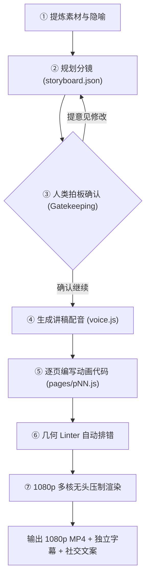

# Code-to-Video 智能体技能包：使用说明全书

> **让任何 AI Coding Agent 化身为专业的“视频总导演、动画程序员与制片人”。**  
> 一句想法、一篇技术文档或一段代码，全自动转化为 1080p 60fps 墨水纸张质感的高清动画解说视频。

---

## 目录
1. [为什么使用代码驱动视频 (Why Code-to-Video)](#一-为什么使用代码驱动视频)
2. [环境准备与四层部署指南](#二-环境准备与四层部署指南)
3. [标准制作五步流水线](#三-标准制作五步流水线)
4. [视频风格与画幅切换指南](#四-视频风格与画幅切换指南)
5. [配音与亚秒级音画同步](#五-配音与亚秒级音画同步)
6. [绘图 API 与组件速查](#六-绘图-api-与组件速查)
7. [各工具与 Agent 挂载指南](#七-各工具与-agent-挂载指南)
8. [核心命令与工具箱速查表](#八-核心命令与工具箱速查表)
9. [常见问题与排错手册 (FAQ)](#九-常见问题与排错手册-faq)

---

## 一、 为什么使用代码驱动视频

市面上的 Seedance、MiniMax H3、可灵等视频生成大模型适合生成氛围感艺术与影视镜头，但在**知识科普、技术讲解、数学推导与教育培训**领域存在难以克服的硬伤：
- ❌ **文字易畸变**：无法原生渲染清晰的公式、代码和多级标题；
- ❌ **抽卡盲盒**：无法局部精细修改，改动一个字往往整段画面变异；
- ❌ **成本高昂**：需要重型 GPU 服务器渲染，生成缓慢。

**Code-to-Video 的解法**：
大模型负责高阶思考，编写标准的声明式前端代码（JavaScript / HTML5 / SVG / KaTeX），由本地的无头浏览器（Headless Chrome）和 FFmpeg 压制。
- ✅ **矢量级绝对清晰**：文字、代码、数学公式 100% 锐利精准；
- ✅ **毫秒级局部可编辑**：改动只需修改几行代码坐标，100% 确定性重绘；
- ✅ **极致音画同步**：利用语音合成时间戳，讲到哪个词，哪个元素刚好动起来；
- ✅ **本地运行极速低成本**：仅消耗少量大模型文本 Token，普通办公电脑即可渲染 1080p。

---

## 二、 环境准备与四层部署指南

> 📘 完整跨设备部署细节也可参阅：[MIGRATION.md](./MIGRATION.md)

由于视频通过代码在无头浏览器中渲染，**不需要昂贵的 GPU 服务器**，任何现代办公电脑（Windows / macOS / Linux）均可丝滑跑满。部署仅需以下四层配置：

### 1. 第一层：基础系统环境（三件套）
* **Node.js（版本 $\ge 22$）**：
  * Windows：`winget install OpenJS.NodeJS.LTS`（或前往 [nodejs.org](https://nodejs.org/) 下载）
  * macOS：`brew install node@22`
* **pnpm 包管理器**：
  ```bash
  corepack enable && corepack prepare pnpm@latest --activate
  # 或 npm install -g pnpm
  ```
* **Chrome 或 Edge 浏览器**：
  * Windows 默认自带的 **Microsoft Edge** 即可直接作为无头渲染器；macOS/Linux 安装 Google Chrome 或 Chromium 即可。底层使用 `playwright-core` 通过 CDP 协议直接复用本机浏览器，无需额外下载数百兆的 Chromium。

### 2. 第二层：渲染引擎与视觉资产依赖（一条命令全自动配齐）
在引擎工程根目录下执行：
```bash
pnpm install && pnpm build
```
该命令会自动安装并配置好所有核心视觉资产，**无需手动安装系统字体或解码器**：
* **内置 FFmpeg（`ffmpeg-static`）**：自动下载对应系统的静态二进制压制工具（支持 NVIDIA `h264_nvenc` 与 Apple `VideoToolbox` `--hw` 硬件加速）。
* **内置跨平台开源字体**：自动安装 **霞鹜文楷（`lxgw-wenkai-webfont`）**、英文手写体 `Caveat`、代码等宽体 `JetBrains Mono` 与圆体数字 `Fredoka`，确保跨系统渲染 100% 像素级一致。
* **内置图形与数学库**：自动挂载 `Rough.js`（手绘物理笔触）、`KaTeX`（数学公式分解）、`Three.js`（3D 场景）与 `simple-icons`（品牌矢量图标）。

### 3. 第三层：语音合成（TTS）与词级时间戳环境（任选其一）
* **方案 A（云端 API，零本地算力）**：设置环境变量 `VOLCENGINE_TTS_API_KEY`（火山引擎）或 `ELEVENLABS_API_KEY`。
* **方案 B（本地 CosyVoice 3 + FunASR 离线满血版，零成本、支持声音克隆）**：
  ```bash
  conda create -n cosyvoice python=3.10 -y && conda activate cosyvoice
  pip install torch torchaudio --index-url https://download.pytorch.org/whl/cu121
  pip install funasr modelscope fastapi uvicorn soundfile
  python voice_service.py --host 127.0.0.1 --port 9880
  ```
* **方案 C（轻量免费版）**：运行 `pip install edge-tts`，免费调用微软“云希/晓晓”音色并导出词级时间轴。

### 4. 第四层：挂载 Skill 与一键环境体检 (Doctor)
```bash
# 克隆本技能到项目目录
git clone https://github.com/BeaverMakerLab/code-to-video-skill.git .agents/skills/code-to-video

# 运行跨设备环境诊断脚本
node .agents/skills/code-to-video/scripts/doctor.mjs
```
终端会逐项输出自检项：
```text
[✓] Node.js: v22.x (已满足 >= 20 要求)
[✓] 渲染浏览器: 找到本地浏览器 (msedge.exe)
[✓] 渲染引擎核心: 已找到 (/path/to/packages/engine)
[✓] 本地语音合成: 检测到 CosyVoice 3 正在 9880 端口运行中
✨ 诊断完成：当前设备已完全具备出片能力！
```

---

## 三、 标准制作五步流水线

与 AI Agent 协作制作视频时，整个过程划分为清晰的人机协作五步法：



### 第一步：素材消化与分镜设计 (Storyboard)
- **指令示例**：
  > *“请阅读当前目录下的 `README.md`，为我设计一个 60 秒的通俗介绍视频分镜。”*
- **产出文件**：`storyboard.json`
- **设计法则**：
  1. **黄金前 3 秒钩子（Hook）**：抛出一个反常识问题；
  2. **单一核心意象**：全片只选一个现实物理比喻（如天平、聚光灯、水箱）；
  3. **明确拍点（Beats）**：每个拍点必须明确动作主体（名词）与动作（动词），绑定口播触发词。

### 第二步：人类拍板确认（必须执行）
AI 会在聊天界面呈现分镜卡片。在进入昂贵的代码绘制前，**用户必须明确确认**。觉得哪一页节奏不对，直接说出修改意见，零试错成本。

### 第三步：讲稿切分与语音合成 (Narration & Audio)
- **产出文件**：`script.js`、`audio/*.wav`、`voice.js`
- 讲稿切分成每句不超过 16 字的字幕短句（cue）。
- 调用语音引擎生成人声，并由算法提取每个汉字的毫秒级起止时间（`k` 数组）。

### 第四步：逐页动画编程与自检 (Page Coding & Linter)
- **产出文件**：`pages/p01.js` ~ `pages/pNN.js`
- 编写时间纯函数 $Visual = f(t)$：
  ```javascript
  ENGINE.visual('p01', (P) => {
    P.title('① 核心直觉', { accent: 'orange' });
    P.card(200, 240, 680, 560, { title: '状态卡片', at: P.c(0) });
    // 词级精准同步：念到“关键”两字触发红圈
    P.ring(540, 520, 160, 80, { color: 'red', at: P.cw(1, '关键') });
  });
  ```
- **自检排错**：运行 `node engine/tools/check.mjs --only p01`。如果产生碰撞警告，AI 会提取 `Fix suggestion` 自动调整坐标直至全绿。

### 第五步：1080p 多核并发压制 (Render)
- 运行并行渲染命令：
  ```bash
  node engine/tools/render.mjs --fps 30 --workers 4
  ```
- 4 个无头 Chrome 进程并发切片捕获 JPEG 帧，FFmpeg 流式合成为 1080p MP4。

---

## 四、 视频风格与画幅切换指南

### 1. 六大内置视觉风格
在 `script.js` 或 `storyboard.json` 中配置 `"style"`：
* `warm-story` *(推荐)*：米黄羊皮纸底色，焦糖点缀，手绘插画风，适合通识科普；
* `chalkboard`：墨绿黑板质感，粉笔笔触，适合数理推导与课堂教学；
* `tech-dark`：深石墨冷调，极简高对比，适合系统架构、AI、代码技术；
* `whiteboard`：会议白板与马克笔圈注，适合产品脑暴与商业图解；
* `study`：象牙白书房质感，钢笔墨水，适合人文历史与研报导读；
* `hydro-sci`：科研网格背景，科学图表，适合水文流体与物理模拟。

### 2. 竖屏画幅（抖音 / 小红书 / 视频号）
* **命令行**：运行渲染时追加 `--portrait`。
* **工程配置**：在 `script.js` 中设置 `META.aspect = '9:16'` 或 `META.portrait = true`。画布自动由 `1920×1080` 切换为 `1080×1920` 竖屏。

### 3. 自定义品牌配色（`META.look`）
在 `script.js` 中直接重载，无需修改页面代码：
```javascript
const META = {
  style: 'warm-story',
  look: {
    palette: { paper: '#0F172A', ink: '#FFFFFF', accent: '#38BDF8' },
    line: { rough: 1.2, sw: 2.5 } // 笔触粗细与潦草度
  }
};
```

---

## 五、 配音与亚秒级音画同步

### 1. 配音方案选型

| 方案 | 成本 | 门槛 | 特色与音色 |
| :--- | :---: | :---: | :--- |
| **本地 CosyVoice 3** | **免费** | 本机运行 Python 9880 端口 | 零成本、极高自然度、支持声音克隆 |
| **微软 Edge-TTS** | **免费** | 运行 `pip install edge-tts` | 抖音同款“云希”音色、自带字幕时间戳 |
| **火山引擎 TTS** | 微付费 | 环境变量配置 `VOLCENGINE_TTS_API_KEY` | 抖音商业级顶流主播音色（渊博小叔） |
| **ElevenLabs** | 微付费 | 环境变量配置 `ELEVENLABS_API_KEY` | 英文出海第一梯队，情绪丰富 |

### 2. 一键合成配音
在工程目录下执行内置脚本：
```bash
node .agents/skills/code-to-video/scripts/narrate.mjs <项目路径> [音色ID]
```

### 3. 词级音画同步核心语法
* `P.c(i, dt)`：第 `i` 句台词开始时刻 + `dt` 秒；
* `P.cw(i, '关键词', dt)`：当台词念到“关键词”发音的**瞬间时刻**；
* `P.endT`：整页口播结束时刻。

---

## 六、 绘图 API 与组件速查

详见手册：[`references/API.md`](./references/API.md)

* **排版文字**：`P.title(str, { accent })`、`P.text(str, { size, color, w, at })`
* **手绘基础图元**：`P.box(...)`、`P.circle(...)`、`P.arrow(...)`、`P.card(...)`、`P.chip(...)`
* **强调与圈注**：`P.ring(cx, cy, w, h)`、`P.underline(x, y, w)`、`P.stamp(x, y, '印章文字')`
* **科研公式分解**：`P.mathDecompose(x, y, w, { title, terms: [{ latex, name, desc, color, at }] })`
* **运镜语言**：`P.push(at, x, y, 1.2)`（特写）、`P.pan(at, x, y)`（平移）、`P.back(at)`（广角）

---

## 七、 各工具与 Agent 挂载指南

本技能采用标准 Markdown 规约与跨平台 Node.js 脚本，可无缝接入各种智能体环境：

1. **Claude Code**：
   在项目根目录 `CLAUDE.md` 中添加：
   ```markdown
   ## 视频生成技能
   当用户要求生成解说视频时，严格遵照 `.agents/skills/code-to-video/SKILL.md` 的步骤执行。
   ```
2. **Antigravity / Agy CLI**：
   默认自动挂载本技能；输入“制作视频”自动激活。
3. **OpenHands / OpenClaw**：
   在仓库根目录 `AGENTS.md` 中声明挂载该技能文件。
4. **DeepSeek Harness / 自建 Agent**：
   将 `SKILL.md` 和 `references/API.md` 作为 System Prompt 或 Tool Context 注入大模型。
5. **Cursor / Windsurf**：
   在聊天窗口中直接输入 `@.agents/skills/code-to-video/SKILL.md` 引用。

---

## 八、 核心命令与工具箱速查表

在任何视频工程目录内均可直接调用的快捷指令：

| 目标操作 | 执行命令 |
| :--- | :--- |
| **体检环境就绪状态** | `node .agents/skills/code-to-video/scripts/doctor.mjs` |
| **快速初始化新工程** | `node .agents/skills/code-to-video/scripts/init_episode.mjs "视频标题" "输出路径" [风格]` |
| **一键合成人声配音** | `node .agents/skills/code-to-video/scripts/narrate.mjs "工程路径" [音色ID]` |
| **检查分镜格式合规性** | `node engine/tools/storyboard-lint.mjs` |
| **查看时间轴与估算时长** | `node engine/tools/pages.mjs` |
| **单页几何排版检测** | `node engine/tools/check.mjs --only p01` |
| **截取单页时间轴拼图** | `node engine/tools/snap.mjs --only p01 --sheet p01 2 5 8` |
| **1080p 多核并发压制** | `node engine/tools/render.mjs --fps 30 --workers 4` |
| **生成多平台发布信息** | `node engine/tools/publish.mjs` |
| **拉起 Web 交互工作台** | `node apps/cli/dist/cli.js serve` |

---

## 九、 常见问题与排错手册 (FAQ)

#### Q1：渲染提示 `ReferenceError: Cannot access 'js' before initialization`？
* **原因**：在 `script.js` 中将已经内置包含的库（如 KaTeX）重复声明到了 `META.libs` 中触发 TDZ 报错。
* **解法**：保持 `libs: []` 即可，基础手绘库与公式库引擎已底层内置。

#### Q2：Linter 警告 `text overlap` 或 `Safe zone overlap`？
* **解法**：严格遵守底部 $y > 900$ 字幕避让红线；提取报错终端给出的 `Fix suggestion: shift y to >= ...` 坐标数值，直接回填修改代码即可。

#### Q3：成片没有声音，只有字幕？
* **原因**：尚未运行配音工具生成 `voice.js` 和 `audio/` 目录。
* **解法**：运行 `node .agents/skills/code-to-video/scripts/narrate.mjs <项目路径>`，确认 `script.js` 的 `META` 中设置了 `voice` 字段后再执行渲染。

#### Q4：如何在全新的独立项目中使用该技能？
* **解法**：设置全局环境变量 `CODE_TO_VIDEO_ENGINE` 指向引擎所在目录（如 `D:\path\to\packages\engine`），脚本即可跨目录建立链接。
